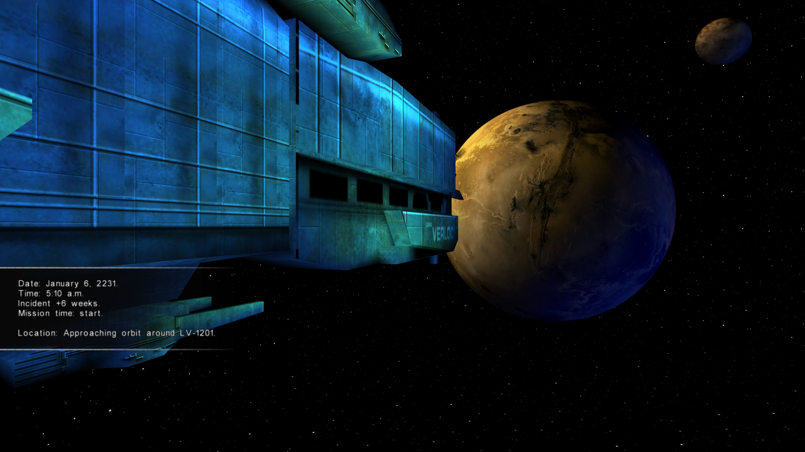
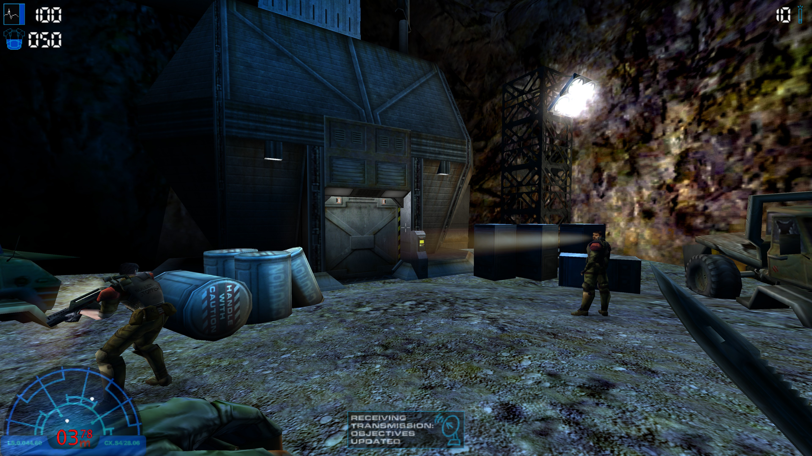
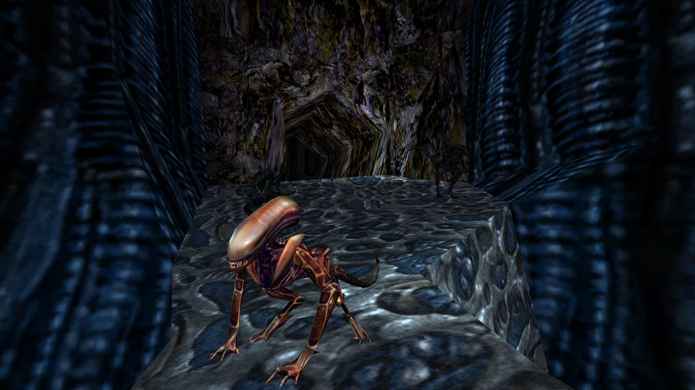
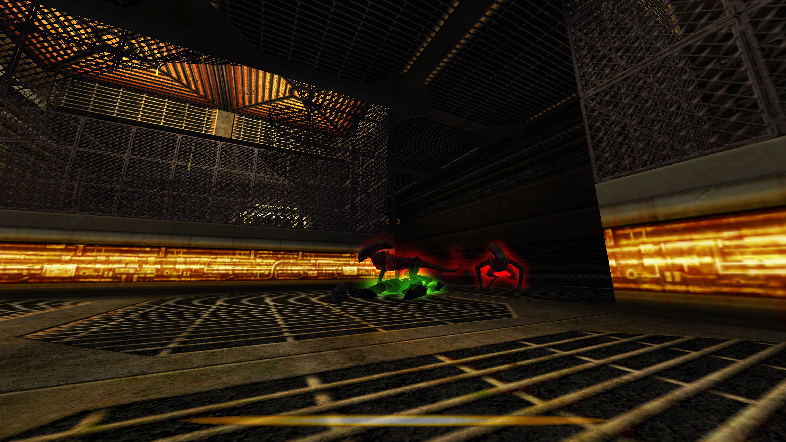
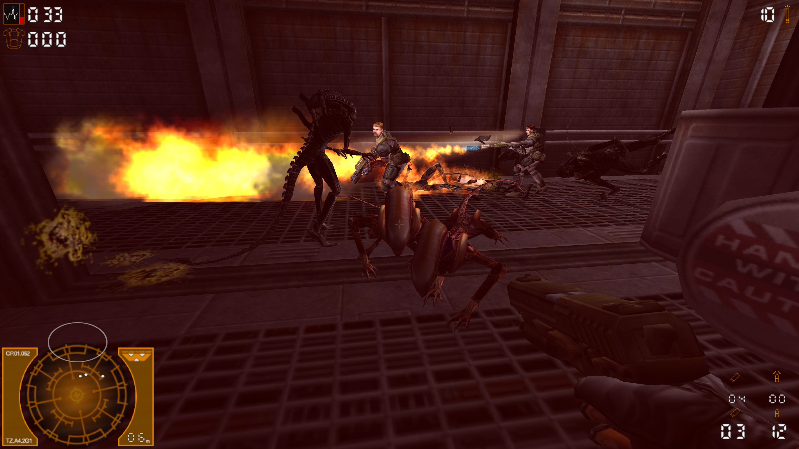

# avp2src

*Aliens versus Predator 2* (Monolith, 2001) and its expansion *Primal
Hunt* (Third Law, 2002), built from source.

<p align="center">
  
  
  
  
  
  
  
  
</p>

<p align="center"><sub>The modern build at 3840x2160: Aliens versus Predator 2 (top) and Primal Hunt (bottom). The menus keep 4:3, and the game uses the full widescreen.</sub></p>

> [!WARNING]
> **Work in progress.** The reconstruction is not complete. Not all the
> functions compile to the retail bytes yet (see
> [`progress/README.md`](progress/README.md)). Work continues to add and
> test the features of the modern build. But the games are playable: AvP2
> and Primal Hunt both start and play on these builds. Expect bugs.

The last release of the game is Primal Hunt 1.0.2.2. Its engine, renderer
and server are the newest. Its game code continues the game code of AvP2
1.0.9.6, which is the last AvP2 patch. Primal Hunt plays only its own
campaigns. Thus the game has two parts:

- The Primal Hunt engine, launcher, dedicated server and game DLLs.
- The AvP2 1.0.9.6 game DLLs, launcher and dedicated server. These play
  the AvP2 campaigns.

Monolith released the AvP2 game code, at 1.0.9.6, in 2002. The release
has these parts:

- the client and server game DLLs,
- their resource DLLs,
- the dedicated server,
- the engine SDK headers,
- the `lithshared` libraries.

Monolith did not release the engine. Nobody released the Primal Hunt code.
AvP2 uses LithTech "Talon", which is the engine generation of *No One Lives
Forever* (2000). Thus the engine here starts from the reconstruction of the
NOLF engine in [nolfsrc](https://github.com/nolffan/nolfsrc). It is changed,
function by function, until it agrees with the Primal Hunt binaries. The
Primal Hunt game DLLs start from the 1.0.9.6 source of Monolith. They are
changed until they agree with the Third Law binaries. As for my other recomp. projects:

- **legacy**: Primal Hunt (Europe) 1.0.2.2 and Aliens versus Predator 2
  (Europe) 1.0.9.6. The source compiles back to the retail binaries byte
  for byte, as far as possible. The build uses the compilers that Monolith
  and Third Law used. These are Visual C++ 6.0, in the revision that the
  Rich header of each binary names, under Wine.
- **modern**: the same source, with fixes and new features (`AVP2SRC_MODERN`).

When the source compiles back to the retail bytes, it also compiles the
bugs of the retail game. The fixes for these bugs are behind
`AVP2SRC_MODERN`, in the modern build only. Thus the legacy build continues
to agree with the retail game.

## Progress

The table in [`progress/README.md`](progress/README.md) shows how much of
each binary compiles to exactly the bytes of the retail game. That file
also tells how the score is calculated.

## Building

### Requirements

You must have Docker.

You must also have the submodules. To get them, do this command:

```sh
git submodule update --init
```

The submodules are:

- `ext/toolchains/`: the compilers.
- `ext/tools/`: the reconstruction tools.
- `ext/openmiles/` and `ext/ffmpeg/`: the open-source audio and video
  libraries. Only the modern build uses them.

You must also have your own images of the three discs: the two discs of
Aliens versus Predator 2 (Europe) and the disc of Primal Hunt (Europe).
The build takes the data of the games from them. This repository does not
supply them. Put the three images in `isos/` at the root of the checkout,
or set `AVP2SRC_ISOS=<directory>` (make gives that directory to the
container, read-only). The directory must hold the files, not symbolic
links to files outside it: the container cannot follow those. A hard link
is good, and it uses no more disk: `ln <image> isos/`. An image can be:

- a `.iso`, with 2048-byte sectors (your own copy, for example);
- a raw `.bin`, with 2352-byte sectors, with or without its `.cue`;
- a `.zip` that holds one `.bin` or `.iso` (the build reads it in place).

For example, the redump dumps of the discs are good images:
`Aliens Versus Predator 2 (Europe) (Disc 1)`,
`Aliens Versus Predator 2 (Europe) (Disc 2)` and
`Aliens Versus Predator 2 - Primal Hunt (Europe)`. Any correct copy of the
discs is good: the build does not check the image as a whole. It finds
each disc by its volume label and size, and it checks each file that it
installs. The AvP2 1.0.9.6 patch is on the Primal Hunt disc. The USA discs
are not sufficient: the AvP2 launcher, readme and EULA on them are not the
European files.

`make retail` (each build does it first) installs the two games from the
images into `out/retail/` one time, as their setups and the patch do
(`build/discs.py`). `build/retail-files.txt` is the list of the installed
files: for each file, its size, its SHA-256, and where it is on which
disc. It holds no game data. Without the images, `make` stops with a
message that tells you what to supply.

### Commands

```sh
make            # build both games into out/avp2-legacy-release/
make test       # start each game under Xvfb and Wine (results in out/play/test/)
make progress   # compare the build with the retail binaries
make help       # show all the commands
```

There are three more builds:

- `make debug`: the legacy build with symbols and `AVP2SRC_DEBUG` logs.
  The output is in `out/avp2-legacy-debug/`.
- `make modern`: the modern build, with `AVP2SRC_MODERN`. The output is in
  `out/avp2-modern-release/`. [`docs/MODERN.md`](docs/MODERN.md) gives
  the changes.
- `make modern-debug`: the modern build with symbols and logs. The output
  is in `out/avp2-modern-debug/`.

These three builds use a copy of the source tree in `out/build-<variant>/`
(`build/variant.sh`). `make progress` does not compare them with the
retail binaries.

### The build without the retail games

`make NODISCS=1` (also with `debug`, `modern` or `modern-debug`) builds
without the disc images. The CI does this
(`.github/workflows/ci.yml`). It compiles all the binaries, the same as a
build with the discs: the retail art that the launchers and the Primal
Hunt dedicated server use is in `assets/art/` (`assets/README.md`). It
copies no game data, and no Bink, Smacker or Miles. Its game directory is
`out/<name>-nodiscs/`, with the file `NOT-PLAYABLE.txt`. You cannot play
this directory: the run scripts and `make test` refuse it. Its public
archive, `out/<name>-public.tar.gz`, is the same as the public archive of
a build with the discs, and you can install it from your discs. It has no
private archive.

`make progress-ci` checks a build against `progress/hashes/`, without the
retail games (`progress/README.md`). `make ci` does the two steps of the CI
for the legacy build: `make NODISCS=1`, then `make progress-ci`.

### The game directory

Each build makes one game directory. The game directory has two
directories, the same as the retail setups make:

- `AVP2/`: Aliens versus Predator 2 1.0.9.6. It has its own engine,
  because the Primal Hunt engine cannot run the AvP2 game DLLs. It also
  has its launcher, the dedicated server `AVP2Serv.exe`, and the game DLLs
  in `custom/`.
- `PrimalHunt/`: Primal Hunt 1.0.2.2. It has its engine, its launcher,
  the dedicated server `AVP2XServ.exe`, and the game DLLs in `custom/`.
  It uses the AvP2 archives in `../AVP2/`.

This project builds all the binaries. The file `MANIFEST.txt` in each
directory gives the source of each file. Only these files come from the
retail games:

- The `.rez` archives. The build sets the retail game DLLs in them to
  zero.
- The movies.
- The other data files: `console.PCX`, `childmodel.map` and, for Primal
  Hunt, `FontData.fnt`.
- The readme files, the default `autoexec.cfg` and the default profile.
- Bink, Smacker and Miles, in the legacy builds only. There is no source
  for them. The modern builds use open-source replacements. `build/ext.sh`
  builds the replacements from `ext/`.

The launcher starts each game with this command:
`lithtech.exe -cmdfile avp2cmds.txt`. The file `avp2cmds.txt` gives the
archives and the game DLLs (`build/avp2cmds.sh`).

### The archives

Each build also makes two archives of its game directory
(`build/package.sh`):

- `out/<name>-private.tar.gz`: with the retail data. Use it on your own
  computers only.
- `out/<name>-public.tar.gz`: without the retail data. You can give it to
  other persons.

The public archive has install scripts (`build/mkinstall.py`). The scripts
copy the data from the player's own disc images: the two AvP2 discs and
the Primal Hunt disc (Europe). They accept a `.iso` file, or a raw
`.bin`/`.cue` file, or a `.zip` file that holds one. They copy the AvP2
1.0.9.6 patch from the Primal Hunt disc. They make sure that each file
they write is correct. `build/mkinstall.py` needs no disc image and no
retail game: `build/retail-files.txt` and `build/retail-ranges.txt` give
where each file is on the discs. The archive ships all our files (the
binaries, the scripts, `MANIFEST.txt`) at their real paths. Its
`SHA256SUMS` lists each file of the archive and each file that the scripts
write, but the settings that the games write again (`autoexec.cfg` and
`Profiles/Default.prf`). Thus `sha256sum -c SHA256SUMS` in the game
directory checks an installation.

To install on Linux, do this command:

```sh
avp2-modern-release/linux-install.sh avp2-1.zip avp2-2.zip ph.zip
```

To install on a Mac (for CrossOver), do this command:

```sh
avp2-modern-release/mac-install.command avp2-1.zip avp2-2.zip ph.zip
```

To install on Windows, drop the three images onto `windows-install.bat`.
This script also writes the registry values that the retail setups wrote.

If you do not give the images, the scripts look for them in the game
directory and in the directory above it. You can do the scripts again.

To upgrade, unpack the new release over your installed game. Use the same
build (legacy or modern) as the installed game. Each archive holds one
directory with the name of its release, so put the files that are in that
directory into the directory of the installed game. On Linux:

```sh
tar xzf avp2src-<release>.tar.gz --strip-components=1 -C /path/to/installed/game
```

On Windows or a Mac, unpack the archive, then copy the files in its
directory into the folder of the installed game, and replace the files that
are there. Do not run the install script again: the release replaces all
of our files, and the files from your discs stay. Your saved games
(`Save`), your profiles and your settings stay too. Then use `sha256sum -c
SHA256SUMS` to check the directory.

### Starting the games

Both archives have scripts that start the games (`build/game-scripts/`).

On Linux, use `linux-run-avp2.sh` or `linux-run-ph.sh`. Each script starts
the game under Wine, in its own Wine prefix (`~/.wine-avp2`). The prefix
has the registry values that the retail setups wrote. These are the
options:

- `--launcher`: start the launcher, not the game.
- `--fullscreen`: use full screen.
- `--windowed`: use a window.
- `--borderless`: use a window with no border, at the desktop resolution.
  Only the modern build has this mode.
- `--res WxH`: use this resolution, for example `--res 1280x720`.
- `--help`: show the options.

If you do not give a window option, the game uses the settings from the
last time.

On Windows, use `windows-run.bat avp2` or `windows-run.bat ph`. You can
also use the launchers:

- In the legacy build, the launchers are `AVP2\AVP2.exe` and
  `PrimalHunt\PrimalHunt.exe`.
- In the modern build, the launchers are `AVP2\AVP2Launcher.exe` and
  `PrimalHunt\PrimalHuntLauncher.exe`. `AVP2.exe` and `PrimalHunt.exe`
  start the game directly.

### A dedicated server

Each game has a dedicated server: `AVP2\AVP2Serv.exe` (AvP2) and
`PrimalHunt\AVP2XServ.exe` (Primal Hunt). A dedicated server has no
player of its own. Players join it from the Multiplayer menu, on the
Internet list or on the LAN list. Each server reads its settings from a
configuration, `ServerData\<name>.txt` in its game directory. The Host
menu of the game saves these files.

On Linux, use `linux-server-avp2.sh` or `linux-server-ph.sh`
(`build/game-scripts/linux-server.sh`, docs/MODERN.md M-26). Each script
starts the server under Wine. These are the options:

- `--config <name>`: use `ServerData/<name>.txt`. The default name is
  `server`. If the file does not exist, the script writes it with default
  settings: deathmatch, 8 players, UDP port 27888, and a random
  server-control password (the script shows it). In the legacy build, the
  server of this file is LAN only. A legacy server that is not LAN only
  crashes (docs/RETAIL_BUGS.md).
- `--wizard`: show the dialog of the server. It lists the configurations
  in `ServerData/`. Select one to start the server.
- `--headless`: run without a display, under `xvfb-run` (install the
  `xvfb` package). This is the default when `$DISPLAY` is not set. The
  server then uses its own Wine prefix: `~/.wine-avp2-server-AVP2` or
  `~/.wine-avp2-server-PrimalHunt`. If a server stopped by force (Ctrl+C),
  the script clears its prefix before the next start.
- `--help`: show the options.

The script gives all other arguments to the server: `-port <n>`,
`-name <text>`, and in the modern build `-MasterServer <host>`. For
example:

```sh
./linux-server-avp2.sh -name "My server"
```

On Windows, start the server with a configuration, for example
`AVP2\AVP2Serv.exe -config server`. Without `-config`, it shows its
dialog. `AVP2XServ.exe` finds the archives of AvP2 through the registry
values of AvP2. `windows-install.bat` writes them, when you run it as an
administrator.

The server uses UDP port 27888 (or the `PortID` of the configuration, or
`-port`). Let this port through the firewall of the server computer.
Players on your LAN need nothing more. For the Internet list, also
forward this UDP port on your router to the server computer. The server
sends its address to the master server. Each player then asks the server
for its details and joins it on this port. Only the modern build has an
Internet list (M-17). The master servers of the legacy build do not
exist now.

## Credits

This project uses the work of others:

- **Monolith Productions**, for *Aliens versus Predator 2* and the LithTech
  engine. Monolith and **Fox Interactive** released the AvP2 game source
  code (v1.0.9.6, 2002). `src/AVP2/` and `src/LT2/` are this source code.
  Monolith also released the *No One Lives Forever 2* source code. The
  launchers and much of `src/lithshared/` come from it
  ([`docs/LICENSE_NOTES.md`](docs/LICENSE_NOTES.md)).
- **Third Law Interactive**, for *Primal Hunt*, and **Sierra**, its
  publisher.
- **OpenMiles** (<https://github.com/maci0/openmiles>), the open
  reimplementation of the Miles Sound System. The modern build uses it in
  place of Miles. Also the miniaudio and TinySoundFont libraries, which
  OpenMiles includes in its source.
- **FFmpeg** (<https://ffmpeg.org>). The Bink player of the modern build
  uses FFmpeg. Also **zlib**, and **Capstone**. The tools use Capstone to
  read the retail machine code.
- **Wine** and **Proton**, which run the game on Linux and on the Steam
  Deck. Also **OpenSpy** (<https://openspy.net>). Its master server
  replaces the GameSpy master server for the Internet games of the modern
  build.
- **redump**, for the verified dumps of the discs. The disc images are
  named here by their redump names.
