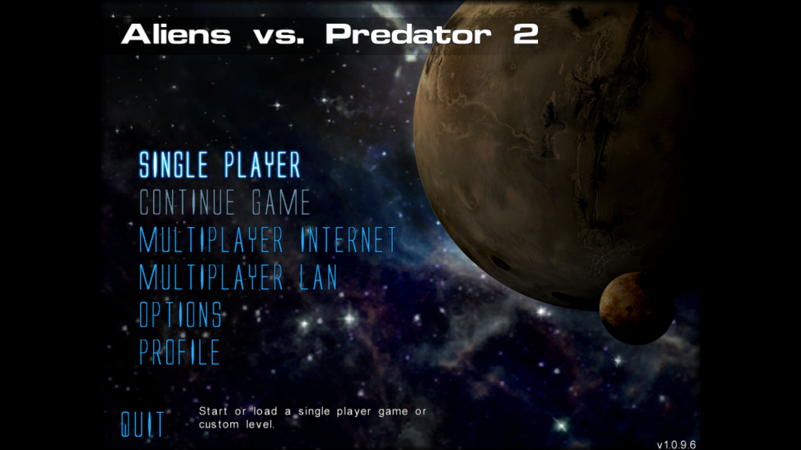
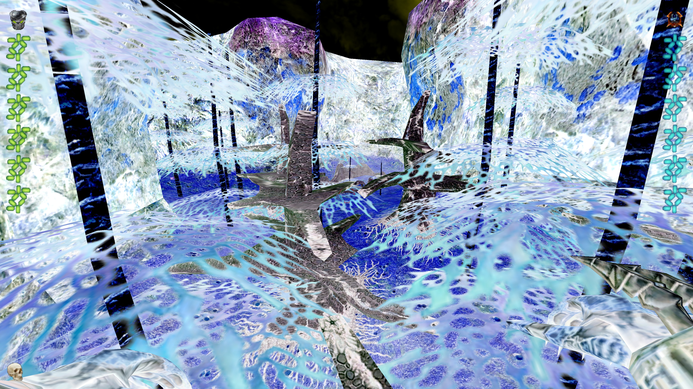
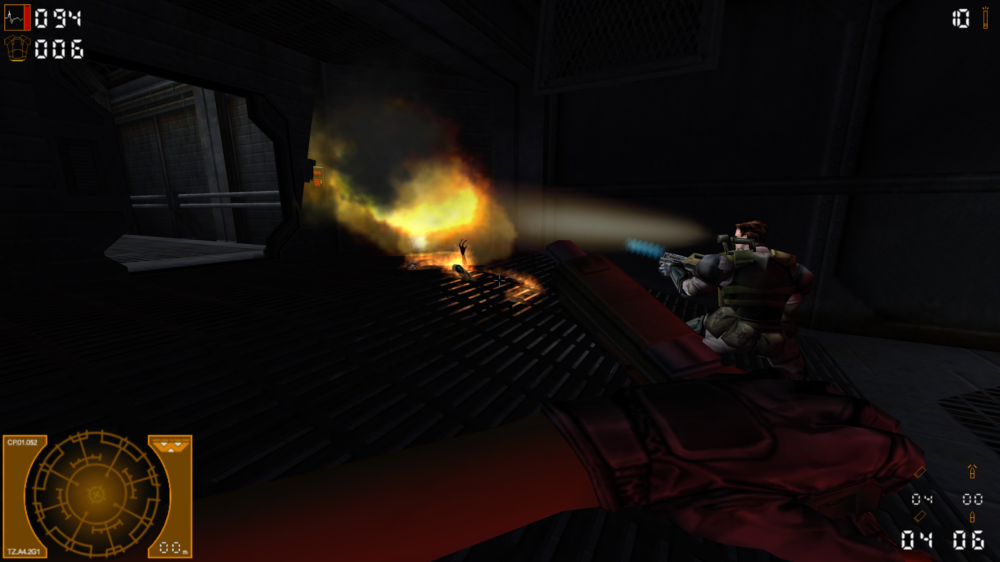

# avp2src

*Aliens versus Predator 2* (Monolith, 2001) and its expansion *Primal
Hunt* (Third Law, 2002), built from source.

<p align="center">
  
  
  
  
  
  
  
  
</p>

<p align="center"><sub>The modern build at 3840x2160: Aliens versus Predator 2 (top) and Primal Hunt (bottom). The menus keep 4:3, and the game uses the full widescreen.</sub></p>

> [!WARNING]
> **Work in progress.** The reconstruction is not complete. Not all the
> functions compile to the retail bytes yet (see
> [`progress/README.md`](progress/README.md)). Work continues to add and
> test the features of the modern build. But the games are playable: AvP2
> and Primal Hunt both start and play on these builds. Expect bugs.

The last release of the game is Primal Hunt 1.0.2.2. Its engine, renderer
and server are the newest. Its game code continues the game code of AvP2
1.0.9.6, which is the last AvP2 patch. Primal Hunt plays only its own
campaigns. Thus the game has two parts:

- The Primal Hunt engine, launcher, dedicated server and game DLLs.
- The AvP2 1.0.9.6 game DLLs, launcher and dedicated server. These play
  the AvP2 campaigns.

Monolith released the AvP2 game code, at 1.0.9.6, in 2002. The release
has these parts:

- the client and server game DLLs,
- their resource DLLs,
- the dedicated server,
- the engine SDK headers,
- the `lithshared` libraries.

Monolith did not release the engine. Nobody released the Primal Hunt code.
AvP2 uses LithTech "Talon", which is the engine generation of *No One Lives
Forever* (2000). Thus the engine here starts from the reconstruction of the
NOLF engine in [nolfsrc](https://github.com/nolffan/nolfsrc). It is changed,
function by function, until it agrees with the Primal Hunt binaries. The
Primal Hunt game DLLs start from the 1.0.9.6 source of Monolith. They are
changed until they agree with the Third Law binaries. As for my other recomp. projects:

- **legacy**: Primal Hunt (Europe) 1.0.2.2 and Aliens versus Predator 2
  (Europe) 1.0.9.6. The source compiles back to the retail binaries byte
  for byte, as far as possible. The build uses the compilers that Monolith
  and Third Law used. These are Visual C++ 6.0, in the revision that the
  Rich header of each binary names, under Wine.
- **modern**: the same source, with fixes and new features (`AVP2SRC_MODERN`).

When the source compiles back to the retail bytes, it also compiles the
bugs of the retail game. The fixes for these bugs are behind
`AVP2SRC_MODERN`, in the modern build only. Thus the legacy build continues
to agree with the retail game.

## Progress

The table in [`progress/README.md`](progress/README.md) shows how much of
each binary compiles to exactly the bytes of the retail game. That file
also tells how the score is calculated.

## Building

### Requirements

You must have Docker.

You must also have the submodules. To get them, do this command:

```sh
git submodule update --init
```

The submodules are:

- `ext/toolchains/`: the compilers.
- `ext/rez/`: the installer. It gets the disc images from archive.org. It
  installs AvP2, the AvP2 1.0.9.6 patch and Primal Hunt.
- `ext/tools/`: the reconstruction tools.
- `ext/openmiles/` and `ext/ffmpeg/`: the open-source audio and video
  libraries. Only the modern build uses them.

### Commands

```sh
make            # build both games into out/avp2-legacy-release/
make test       # start each game under Xvfb and Wine (results in out/play/test/)
make progress   # compare the build with the retail binaries
make help       # show all the commands
```

There are three more builds:

- `make debug`: the legacy build with symbols and `AVP2SRC_DEBUG` logs.
  The output is in `out/avp2-legacy-debug/`.
- `make modern`: the modern build, with `AVP2SRC_MODERN`. The output is in
  `out/avp2-modern-release/`. [`docs/MODERN.md`](docs/MODERN.md) gives
  the changes.
- `make modern-debug`: the modern build with symbols and logs. The output
  is in `out/avp2-modern-debug/`.

These three builds use a copy of the source tree in `out/build-<variant>/`
(`build/variant.sh`). `make progress` does not compare them with the
retail binaries.

### The game directory

Each build makes one game directory. The game directory has two
directories, the same as the retail setups make:

- `AVP2/`: Aliens versus Predator 2 1.0.9.6. It has its own engine,
  because the Primal Hunt engine cannot run the AvP2 game DLLs. It also
  has its launcher, the dedicated server `AVP2Serv.exe`, and the game DLLs
  in `custom/`.
- `PrimalHunt/`: Primal Hunt 1.0.2.2. It has its engine, its launcher,
  the dedicated server `AVP2XServ.exe`, and the game DLLs in `custom/`.
  It uses the AvP2 archives in `../AVP2/`.

This project builds all the binaries. The file `MANIFEST.txt` in each
directory gives the source of each file. Only these files come from the
retail games:

- The `.rez` archives. The build sets the retail game DLLs in them to
  zero.
- The movies.
- The other data files: `console.PCX`, `childmodel.map` and, for Primal
  Hunt, `FontData.fnt`.
- The readme files, the default `autoexec.cfg` and the default profile.
- Bink, Smacker and Miles, in the legacy builds only. There is no source
  for them. The modern builds use open-source replacements. `build/ext.sh`
  builds the replacements from `ext/`.

The launcher starts each game with this command:
`lithtech.exe -cmdfile avp2cmds.txt`. The file `avp2cmds.txt` gives the
archives and the game DLLs (`build/avp2cmds.sh`).

### The archives

Each build also makes two archives of its game directory
(`build/package.sh`):

- `out/<name>-private.tar.gz`: with the retail data. Use it on your own
  computers only.
- `out/<name>-public.tar.gz`: without the retail data. You can give it to
  other persons.

The public archive has install scripts (`build/mkinstall.py`). The scripts
copy the data from the player's own disc images: the two AvP2 discs and
the Primal Hunt disc. The European discs are the default. The scripts also
accept some USA discs. They accept a `.iso` file, or a redump `.bin`/`.cue`
or `.zip` file. They copy the AvP2 1.0.9.6 patch from the Primal Hunt disc.
They make sure that each file they write is correct.

To install on Linux, do this command:

```sh
avp2-modern-release/linux-install.sh avp2-1.zip avp2-2.zip ph.zip
```

To install on a Mac (for CrossOver), do this command:

```sh
avp2-modern-release/mac-install.command avp2-1.zip avp2-2.zip ph.zip
```

To install on Windows, drop the three images onto `windows-install.bat`.
This script also writes the registry values that the retail setups wrote.

If you do not give the images, the scripts look for them in the game
directory and in the directory above it. You can do the scripts again.

### Starting the games

Both archives have scripts that start the games (`build/game-scripts/`).

On Linux, use `linux-run-avp2.sh` or `linux-run-ph.sh`. Each script starts
the game under Wine, in its own Wine prefix (`~/.wine-avp2`). The prefix
has the registry values that the retail setups wrote. These are the
options:

- `--launcher`: start the launcher, not the game.
- `--fullscreen`: use full screen.
- `--windowed`: use a window.
- `--borderless`: use a window with no border, at the desktop resolution.
  Only the modern build has this mode.
- `--res WxH`: use this resolution, for example `--res 1280x720`.
- `--help`: show the options.

If you do not give a window option, the game uses the settings from the
last time.

On Windows, use `windows-run.bat avp2` or `windows-run.bat ph`. You can
also use the launchers:

- In the legacy build, the launchers are `AVP2\AVP2.exe` and
  `PrimalHunt\PrimalHunt.exe`.
- In the modern build, the launchers are `AVP2\AVP2Launcher.exe` and
  `PrimalHunt\PrimalHuntLauncher.exe`. `AVP2.exe` and `PrimalHunt.exe`
  start the game directly.

## Credits

This project uses the work of others:

- **Monolith Productions**, for *Aliens versus Predator 2* and the LithTech
  engine. Monolith and **Fox Interactive** released the AvP2 game source
  code (v1.0.9.6, 2002). `src/AVP2/` and `src/LT2/` are this source code.
  Monolith also released the *No One Lives Forever 2* source code. The
  launchers and much of `src/lithshared/` come from it
  ([`docs/LICENSE_NOTES.md`](docs/LICENSE_NOTES.md)).
- **Third Law Interactive**, for *Primal Hunt*, and **Sierra**, its
  publisher.
- **OpenMiles** (<https://github.com/maci0/openmiles>), the open
  reimplementation of the Miles Sound System. The modern build uses it in
  place of Miles. Also the miniaudio and TinySoundFont libraries, which
  OpenMiles includes in its source.
- **FFmpeg** (<https://ffmpeg.org>). The Bink player of the modern build
  uses FFmpeg. Also **zlib**, and **Capstone**. The tools use Capstone to
  read the retail machine code.
- **Wine** and **Proton**, which run the game on Linux and on the Steam
  Deck. Also **OpenSpy** (<https://openspy.net>). Its master server
  replaces the GameSpy master server for the Internet games of the modern
  build.
- **redump.org**, for the verified disc images that the installers check
  against. Also **archive.org**, which keeps these images.
